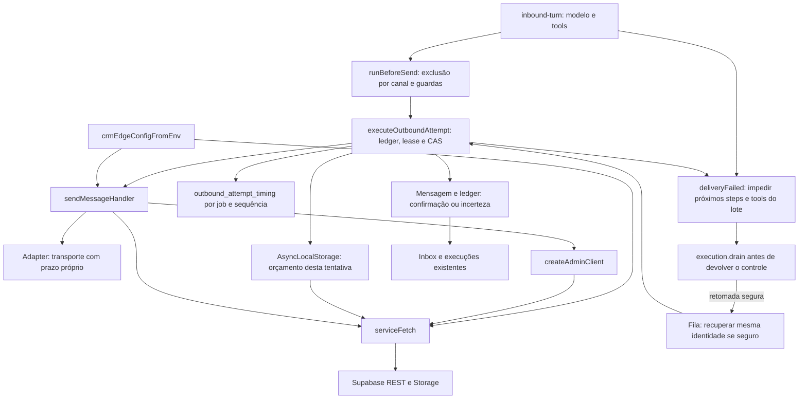

# Esperas e recuperação da entrega

`serviceFetch` está nos dois clients de serviço, nunca no client autenticado do
browser. `withServiceRequestBudget` cria um escopo por tentativa. Instâncias dos
clients podem ser compartilhadas, mas o relógio não passa para outra tentativa,
cliente ou organização. O transporte inicia uma fase independente. No pós-envio,
cada request conserva seu prazo, sem herdar o tempo gasto pela etapa anterior.

O sinal do fetch limita espera por headers e body. Ele **não prova rollback de
uma escrita no servidor**. Por isso não substitui a identidade persistida, o lease,
o CAS nem a reconciliação por ACK. Não há Promise.race liberando ferramentas ainda
ativas. Recusa de mídia/guardrail corrigível não é tratada como falha fatal de
transporte; o modelo pode continuar por texto quando permitido.

O estado de entrega continua visível nas telas atuais; duração por fase é log
operacional. Não foi adicionada configuração comercial, regra de workspace ou
tela de telemetria. Os limites HTTP não são uma promessa de tempo total: inferência,
fila, consultas SQL e transporte também compõem a latência.

Diagnóstico, prazos, evidências e checklist:
[Esperas no caminho de envio](../testing/inbound-delivery-latency.md).
